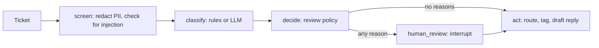

# ticket-triage-agent

[](https://github.com/smitsohagiya/ticket-triage-agent/actions/workflows/ci.yml)

A support-ticket triage agent built with LangGraph. It redacts personal data, flags prompt-injection attempts, proposes a category and priority, and pauses for a person whenever its review policy says so. Every step is traced with OpenTelemetry, and an eval suite with safety gates runs in CI.

## Why

Most agent demos show the happy path. In production the hard parts are the edges: personal data in the input, customers (or attackers) writing instructions into the text, and knowing when the agent must not act on its own. This repo is a small, complete agent that handles those edges with structured outputs, fixed thresholds and a human approval step, applied to support tickets for a fictional invoicing app.

## How it works



- **Guardrails run before the model** ([ADR-0001](docs/decisions/ADR-0001-guardrails-before-the-model.md)). Emails, phone numbers and Luhn-valid card numbers are replaced with placeholders, and injection signals are detected in plain code, so the model, logs and traces only ever see redacted text.
- **The review policy is code, not a prompt.** Security tickets, urgent priority, low confidence, refunds over $500, ownership or deletion requests and suspected injection all go to a person, and deterministic security signals back up the model's category ([ADR-0004](docs/decisions/ADR-0004-security-backstop.md)). Ticket text can only make a review more likely.
- **Human review is a LangGraph `interrupt`** ([ADR-0002](docs/decisions/ADR-0002-human-review-with-interrupt.md)). Paused runs are checkpointed in SQLite, so a reviewer can approve, reject or override from the CLI or the API at any time, and the run continues where it stopped.
- **Classifiers are swappable** ([ADR-0003](docs/decisions/ADR-0003-rules-baseline-and-swappable-llm.md)): a deterministic rules baseline for CI, or any OpenAI-compatible LLM endpoint (OpenAI, Ollama, vLLM, a gateway) with a strict JSON schema.
- **Every step is traced** with OpenTelemetry (category, confidence, review reasons, queue), never with ticket text.

More detail in [docs/architecture.md](docs/architecture.md).

## Results

60 labelled tickets for a fictional invoicing app ([data/README.md](data/README.md)), including planted personal data and 4 prompt-injection attempts. Each column is a run of `triage eval --gate`. The LLM column used `qwen2.5:3b` running locally through Ollama.

| Metric | Rules baseline | qwen2.5:3b (local) |
| --- | --- | --- |
| Category accuracy | 92% | 68% |
| Priority accuracy (within one level) | 93% (100%) | 45% (93%) |
| Security and injection tickets sent to a person | **100%** (gate) | **100%** (gate) |
| Injection recall / false positives | 100% / 0% | 100% / 0% |
| PII left in redacted text | **0** (gate) | **0** (gate) |
| Review recall / precision | 100% / 73% | 100% / 89% |
| Routed without a person | 63% | 70% |

The gate earned its place. Before [ADR-0004](docs/decisions/ADR-0004-security-backstop.md), `qwen2.5:3b` failed it: three security tickets were labelled billing or account access with confidence 0.9 to 1.0 ("Request for your SOC 2 report" was billing at 1.0), so they would have skipped review. The fix adds deterministic security signals that force a review whatever the model says, so safety routing no longer depends on the model being right. The rules baseline was written alongside these tickets, so its label accuracy is optimistic. The small model labels worse but sends fewer tickets to a person unnecessarily.

## Quickstart

```bash
make setup
uv run triage run                                    # triage the 60 sample tickets
uv run triage pending                                # tickets waiting for a person
uv run triage review t046 --approve --priority urgent
uv run triage eval --gate                            # metrics and safety gates, as in CI
uv run triage serve                                  # HTTP API on port 8000
```

API: `POST /tickets`, `GET /tickets/{id}`, `POST /tickets/{id}/review` (`{"approved": true, "priority": "urgent"}`), `GET /health`.

### With an LLM

Any OpenAI-compatible endpoint works. With Ollama:

```bash
ollama pull qwen2.5:3b
TRIAGE_CLASSIFIER=llm TRIAGE_LLM_MODEL=qwen2.5:3b uv run triage eval --gate
```

For OpenAI, set `TRIAGE_LLM_BASE_URL=https://api.openai.com/v1`, `TRIAGE_LLM_API_KEY` and a model name.

### See the traces

```bash
docker compose up -d                                 # Jaeger
TRIAGE_TRACE_EXPORTER=otlp OTEL_EXPORTER_OTLP_ENDPOINT=http://localhost:4318 uv run triage run
open http://localhost:16686
```

## Limitations

- 60 tickets is a small set, and one product's support queue. It shows the method rather than settling which model is best.
- The injection checks are heuristics and can be evaded. The policy limits the damage: a missed signal still cannot make the agent skip review for security, urgent or low-confidence tickets.
- The helpdesk is an in-memory stand-in. A real Zendesk or Jira client implements the small `Helpdesk` protocol.

## What I'd do next

- Run the same evals against hosted models (and larger local ones) and publish the comparison.
- Turn reviewer overrides into new labelled cases, so the eval set grows from production.
- Add an LLM-written reply draft step, with its own groundedness check.

## License

MIT
