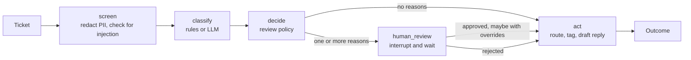

# Architecture

| Step | What it does | Why it is a separate step |
| --- | --- | --- |
| `screen` | Replaces emails, phone numbers and Luhn-valid card numbers with placeholders, and checks for prompt-injection signals. | The model, the logs and the traces never see personal data, and injection is detected before any model reads the text (ADR-0001). |
| `classify` | Proposes a category, priority and confidence. | The classifier is swappable: a deterministic rules baseline or any OpenAI-compatible LLM (ADR-0003). |
| `decide` | Applies the review policy: security, urgent, low confidence, refunds over $500, ownership or deletion requests, and suspected injection all go to a person. | The policy reads the proposal but is never written by the model, so ticket text can only make review more likely. |
| `human_review` | Pauses with `interrupt` and waits for a reviewer's answer. | Runs are checkpointed in SQLite, so a reviewer can answer from the CLI or the API at any time (ADR-0002). |
| `act` | Routes the ticket to a queue, tags it and writes a reply draft for simple tickets. | Helpdesk actions sit behind a small protocol, so a real Zendesk or Jira client is one class. |

Every step records an OpenTelemetry span with the decision as attributes (category, confidence, review reasons, queue). Spans never contain ticket text.
